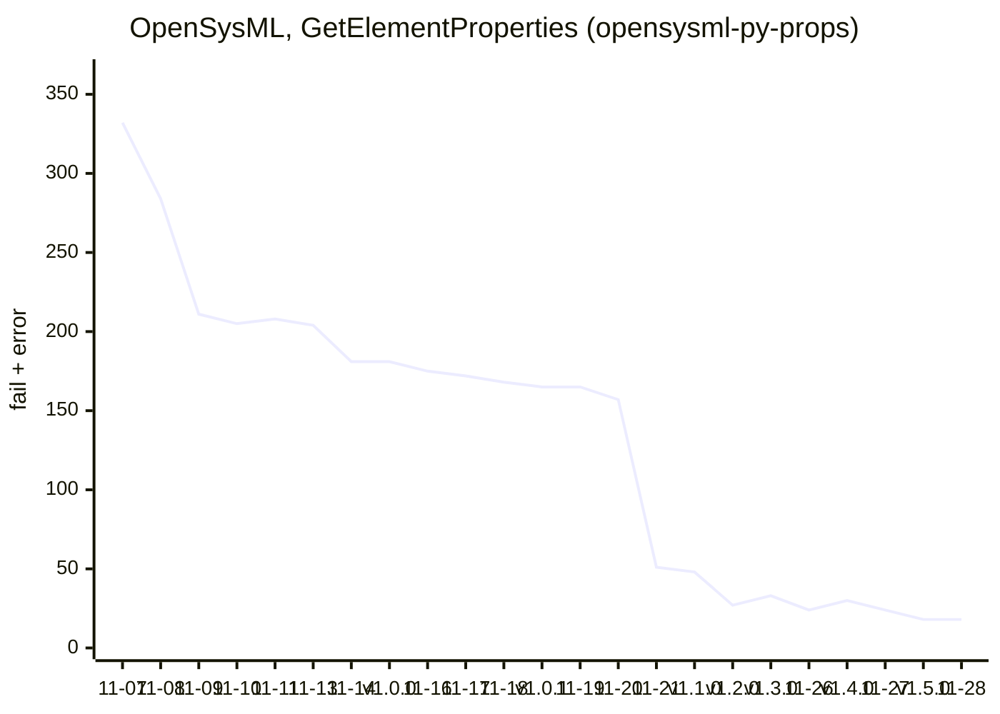
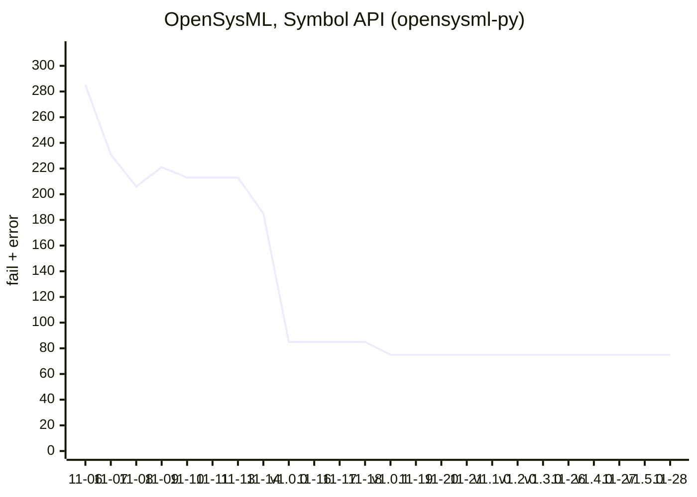
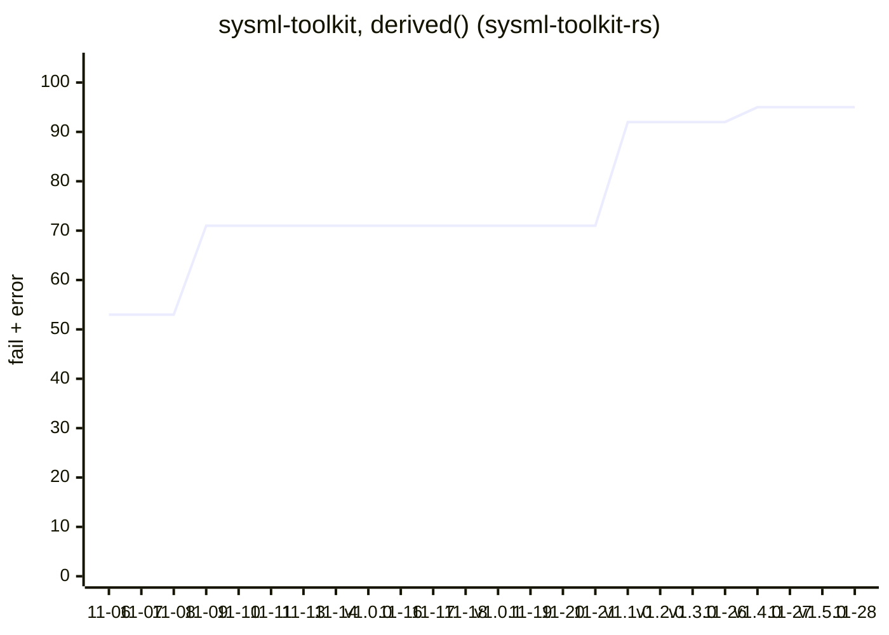
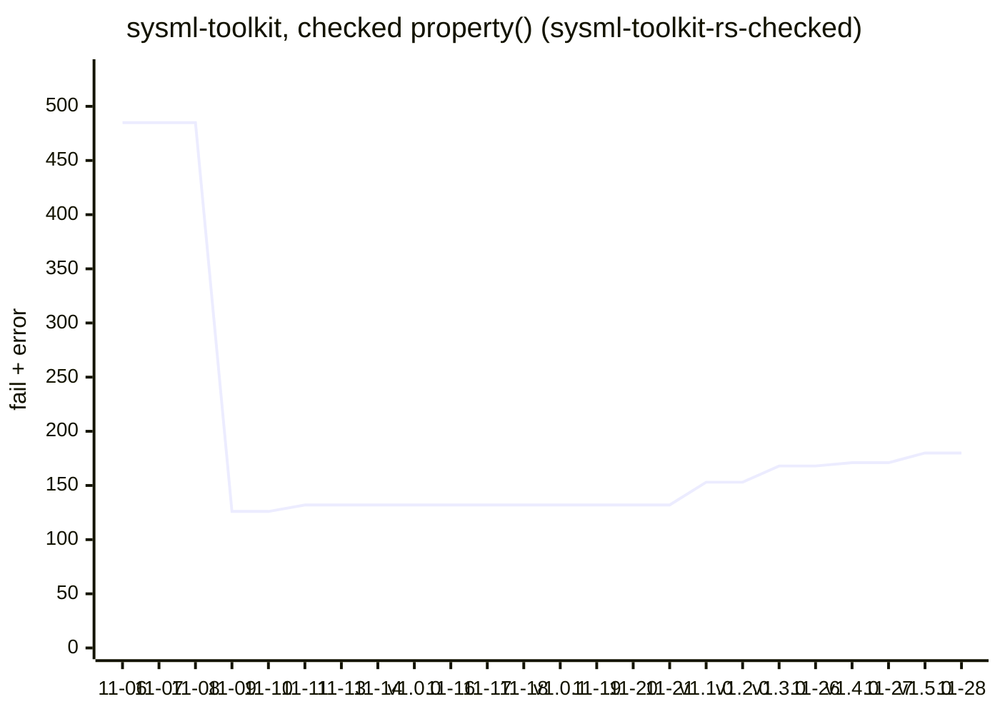

# Progress of the SysML v2 MDKs

How the results moved, snapshot by snapshot. Each point is one version of
[report-all-SNAPSHOT.md](report-all-SNAPSHOT.md), from its history in git.
Generated by `test-suite/progress.py`, which `update-snapshots.sh` runs; do not edit by hand.

The charts plot the last snapshot of each day and each release; the table lists every
snapshot. They count **fail + error** per suite: cases an MDK answered wrongly, or could not
answer for an error. Unsupported cases (a read the API does not offer) are left out.
The suite grows over time: a release adds cases, and new cases may fail at first.
So the count can rise without any MDK changing. Release tags mark the last snapshot
each release contains; [DISCUSSIONS.md](../DISCUSSIONS.md) explains every step.

Latest: 2128 cases, OpenSysML `8e95d5fd87`, sysml-toolkit `v0.13.0`, Pilot `82d26f18a7`.

## Charts

The Pilot is the reference: its expected values are the suite's, and it has failed no
case since the first snapshot.

## Snapshots

Newest first. The suite columns give fail + error; – means the suite did not exist yet.

|date|snapshot|release|cases|OpenSysML|sysml-toolkit|Pilot|py-props|go-props|py|go|rs|ts|ts-wasm|java|toolkit|toolkit-checked|Pilot|what changed|
|--|--|--|--:|--|--|--|--:|--:|--:|--:|--:|--:|--:|--:|--:|--:|--:|--|
|2026-11-28|working tree||2128|`8e95d5fd87`|`v0.13.0`|`82d26f18a7`|18|18|75|75|85|85|85|85|95|180|0|this snapshot (written with it, not yet committed)|
|2026-11-28|[`ce6c644`](https://github.com/hideo67/sysmlv2-tests/commit/ce6c644c05f115478012adc440f8bdb19a41d441)|[v1.5.0](https://github.com/hideo67/sysmlv2-tests/releases/tag/v1.5.0)|2128|`15f2dc088d`|`v0.13.0`|`82d26f18a7`|18|18|75|75|85|85|85|85|95|180|0|2128 cases (C21 plain operators); no MDK change.|
|2026-11-28|[`d9726ff`](https://github.com/hideo67/sysmlv2-tests/commit/d9726ff9c8a70883f11aaa30b8ac76037fb60a49)||2065|`15f2dc088d`|`v0.13.0`|`82d26f18a7`|18|18|75|75|85|85|85|85|95|171|0|OpenSysML at 15f2dc088d (#2701 fixes #2698; props +6).|
|2026-11-27|[`1da31bf`](https://github.com/hideo67/sysmlv2-tests/commit/1da31bfc58bce8144df525ff9faa65638f0c77a8)||2065|`1a5ab88061`|`v0.13.0`|`82d26f18a7`|24|24|75|75|85|85|85|85|95|171|0|OpenSysML at 1a5ab88061 (#2617 action node parameters; props +6).|
|2026-11-27|[`ee6c679`](https://github.com/hideo67/sysmlv2-tests/commit/ee6c67999405e554482e00e1b7a31e1b710b9c3a)|[v1.4.0](https://github.com/hideo67/sysmlv2-tests/releases/tag/v1.4.0)|2065|`59fd3b6c3e`|`v0.13.0`|`82d26f18a7`|30|30|75|75|85|85|85|85|95|171|0|2065 cases (C21 feature chain operator); no MDK change.|
|2026-11-27|[`a6564a7`](https://github.com/hideo67/sysmlv2-tests/commit/a6564a74bd073ccc88423514bfc09f999cfe8ef2)||2044|`59fd3b6c3e`|`v0.13.0`|`82d26f18a7`|24|24|75|75|85|85|85|85|92|168|0|OpenSysML at 59fd3b6c3e (no case moved).|
|2026-11-26|[`5b96cfe`](https://github.com/hideo67/sysmlv2-tests/commit/5b96cfe2c0e0892a1ccdfa138c3e04936af534a5)||2044|`8b71b726c1`|`v0.13.0`|`82d26f18a7`|24|24|75|75|85|85|85|85|92|168|0|OpenSysML at 8b71b726c1 (no case moved).|
|2026-11-26|[`0d9bd04`](https://github.com/hideo67/sysmlv2-tests/commit/0d9bd04241c88e301652dfb85b88e6b339b153ec)||2044|`93a6a8ef2e`|`v0.13.0`|`82d26f18a7`|24|24|75|75|85|85|85|85|92|168|0|OpenSysML at 93a6a8ef2e (#2624 fixes #2620; props +12).|
|2026-11-25|[`39298e6`](https://github.com/hideo67/sysmlv2-tests/commit/39298e6c6cd3dbe62026baac3e19bf3b8d9b8994)|[v1.3.0](https://github.com/hideo67/sysmlv2-tests/releases/tag/v1.3.0)|2044|`60680a21ed`|`v0.13.0`|`82d26f18a7`|33|33|75|75|85|85|85|85|92|168|0|2044 cases (C31 added, C21 type operators); no MDK change.|
|2026-11-25|[`a497865`](https://github.com/hideo67/sysmlv2-tests/commit/a497865523dcaf2f21b1183f350c9c828c3aa970)||1939|`60680a21ed`|`v0.13.0`|`82d26f18a7`|24|24|75|75|85|85|85|85|92|153|0|OpenSysML at 60680a21ed (#2589 for loop variable; props +3), sysml-toolkit v0.13.0.|
|2026-11-24|[`94c6d79`](https://github.com/hideo67/sysmlv2-tests/commit/94c6d790c8d5586f13ab3e0fe3eb6e2bbffbe4be)|[v1.2.0](https://github.com/hideo67/sysmlv2-tests/releases/tag/v1.2.0)|1939|`262a110859`|`v0.12.0`|`82d26f18a7`|27|27|75|75|85|85|85|85|92|153|0|1939 cases, OpenSysML at 262a110859 (#2549 fixes #2495; #2558; props +45).|
|2026-11-23|[`8781ea3`](https://github.com/hideo67/sysmlv2-tests/commit/8781ea34f332fc10e215e4c1787c5c41a1686467)|[v1.1.0](https://github.com/hideo67/sysmlv2-tests/releases/tag/v1.1.0)|1915|`013190a6f5`|`v0.12.0`|`82d26f18a7`|48|48|75|75|85|85|85|85|92|153|0|1915 cases (#2495 cases added), OpenSysML at 013190a6f5.|
|2026-11-23|[`ee692af`](https://github.com/hideo67/sysmlv2-tests/commit/ee692af385d7f8545317cac1551c3ab7d319bbaa)||1813|`013190a6f5`|`v0.12.0`|`82d26f18a7`|27|27|75|75|85|85|85|85|71|132|0|OpenSysML at 013190a6f5 (#2516; props suites +24, B20 passes).|
|2026-11-23|[`2cd16e3`](https://github.com/hideo67/sysmlv2-tests/commit/2cd16e3014fec095a9bc5b2d00fa857788ee6193)||1813|`9347078fb3`|`v0.12.0`|`82d26f18a7`|51|51|75|75|85|85|85|85|71|132|0|OpenSysML at 9347078fb3 (#2496, #2509; no case moved).|
|2026-11-21|[`e9f300e`](https://github.com/hideo67/sysmlv2-tests/commit/e9f300e5a5d559627ca683032f045b36cf86430b)||1813|`2d8bbc7a96`|`v0.12.0`|`82d26f18a7`|51|51|75|75|85|85|85|85|71|132|0|OpenSysML at 2d8bbc7a96 (#2042 merged; props suites +106).|
|2026-11-21|[`b12f1ee`](https://github.com/hideo67/sysmlv2-tests/commit/b12f1ee22d3f63fa29bead2a883082c46b0b020a)||1813|`aa03065f72`|`v0.12.0`|`82d26f18a7`|157|157|75|75|85|85|85|85|71|132|0|OpenSysML at aa03065f72 (#2048 self-model QVTS, #2490; no case moved).|
|2026-11-21|[`48a2ada`](https://github.com/hideo67/sysmlv2-tests/commit/48a2ada7debf0ce9387bbe0808da5efa83677eb7)||1813|`753f597e17`|`v0.12.0`|`82d26f18a7`|157|157|75|75|85|85|85|85|71|132|0|OpenSysML at 753f597e17 (#2324 imported memberships, #2142 metaclasses; no case moved).|
|2026-11-20|[`ff11b75`](https://github.com/hideo67/sysmlv2-tests/commit/ff11b751b8dce1157e0bbe58037c0f77083bafc6)||1813|`fe073d042d`|`v0.12.0`|`82d26f18a7`|157|157|75|75|85|85|85|85|71|132|0|OpenSysML at fe073d042d (#2002 expression implied bases, #2424; no case moved).|
|2026-11-20|[`127763f`](https://github.com/hideo67/sysmlv2-tests/commit/127763f0552a2521e461660b3ce0f905ade6fbb7)||1813|`1f208d2c97`|`v0.12.0`|`82d26f18a7`|157|157|75|75|85|85|85|85|71|132|0|Pilot at 82d26f18a7 (#828; no case moved).|
|2026-11-20|[`a289038`](https://github.com/hideo67/sysmlv2-tests/commit/a2890384b788c1d66070c23dfd61e10daa0c3b5d)||1813|`1f208d2c97`|`v0.12.0`|`378a8700c0`|157|157|75|75|85|85|85|85|71|132|0|OpenSysML at 1f208d2c97 (#2414 cross subsetting; no case moved).|
|2026-11-20|[`5b59682`](https://github.com/hideo67/sysmlv2-tests/commit/5b59682a85756ac5b98460f63a8e4ac3bc85190e)||1813|`109d8faa0e`|`v0.12.0`|`378a8700c0`|157|157|75|75|85|85|85|85|71|132|0|OpenSysML at 109d8faa0e (#2309 inherited family, endFeature fixes).|
|2026-11-19|[`3355aff`](https://github.com/hideo67/sysmlv2-tests/commit/3355aff4ce6e313181bb29e1082995d0d6935772)||1813|`19a9be9a31`|`v0.12.0`|`378a8700c0`|165|165|75|75|85|85|85|85|71|132|0|OpenSysML at 19a9be9a31 (#2311; no case moved).|
|2026-11-19|[`1e1ed4d`](https://github.com/hideo67/sysmlv2-tests/commit/1e1ed4dba1832d9bded3fa473f27073719163cb5)|[v1.0.1](https://github.com/hideo67/sysmlv2-tests/releases/tag/v1.0.1)|1813|`13038ee707`|`v0.12.0`|`378a8700c0`|165|165|75|75|85|85|85|85|71|132|0|OpenSysML at 13038ee707 (#2263 Feature::type, #2251 relative direction) and the Go adapter's AsMemberOf.|
|2026-11-18|[`f8ae040`](https://github.com/hideo67/sysmlv2-tests/commit/f8ae0402f10fc66ed781936c9ccd90dee277dc7b)||1813|`9add4822df`|`v0.12.0`|`378a8700c0`|168|168|85|85|85|85|85|85|71|132|0|OpenSysML at 9add4822df (#2359 chain expression operator).|
|2026-11-17|[`9f7bc36`](https://github.com/hideo67/sysmlv2-tests/commit/9f7bc36217ddd867ae12ebd7039ac1a12732cc16)||1813|`65d6c25003`|`v0.12.0`|`378a8700c0`|172|172|85|85|85|85|85|85|71|132|0|OpenSysML at 65d6c25003 (#2268 end features, #2266 flow ends).|
|2026-11-17|[`29af3ef`](https://github.com/hideo67/sysmlv2-tests/commit/29af3ef68deb1a2e3939c8565958881a658e852a)||1813|`a5198b609f`|`v0.12.0`|`378a8700c0`|175|175|85|85|85|85|85|85|71|132|0|OpenSysML at a5198b609f (#2279 occurrence usages; no case moved).|
|2026-11-16|[`a9de6b7`](https://github.com/hideo67/sysmlv2-tests/commit/a9de6b794b485eebaa615d7e57d2b7c8e1c7e54e)||1813|`5cb054db65`|`v0.12.0`|`378a8700c0`|175|175|85|85|85|85|85|85|71|132|0|OpenSysML at 5cb054db65 (twenty merges, no case moved).|
|2026-11-16|[`fdeac6d`](https://github.com/hideo67/sysmlv2-tests/commit/fdeac6d1bf00f4fcbdc0bc3dcdd46c2580e121bc)||1813|`b9f9d5da50`|`v0.12.0`|`378a8700c0`|175|175|85|85|85|85|85|85|71|132|0|OpenSysML at b9f9d5da50 (#2259 successions at unnamed nodes, #2255).|
|2026-11-15|[`482489e`](https://github.com/hideo67/sysmlv2-tests/commit/482489e4f20b1533a351a16492986582b3069758)|[v1.0.0](https://github.com/hideo67/sysmlv2-tests/releases/tag/v1.0.0)|1813|`dd08d75454`|`v0.12.0`|`378a8700c0`|181|181|85|85|85|85|85|85|71|132|0|OpenSysML at dd08d75454 (#2206 Symbol connector ends, #2209 annotating metadata adopted).|
|2026-11-14|[`72eb476`](https://github.com/hideo67/sysmlv2-tests/commit/72eb476cb4c529888c976b844ba392053ab65659)||1813|`dd05a85437`|`v0.12.0`|`378a8700c0`|181|181|185|185|185|185|185|185|71|132|0|OpenSysML at dd05a85437 (#2205 name resolution, #2210, #2220-#2222 transition successions) and the Symbol adapter fixes.|
|2026-11-13|[`2cc014f`](https://github.com/hideo67/sysmlv2-tests/commit/2cc014f12c9305c029772529a3987af0a1670f8b)||1813|`a159469093`|`v0.12.0`|`378a8700c0`|204|204|213|223|213|223|223|223|71|132|0|OpenSysML at a159469093 (#2161 isReference, #2133 state then transitions, #2143 and more).|
|2026-11-11|[`c4d0fc6`](https://github.com/hideo67/sysmlv2-tests/commit/c4d0fc69d8141d39f8a46ce9edf0ea9e971b6e28)||1813|`c708674d36`|`v0.12.0`|`378a8700c0`|208|208|213|223|213|223|223|223|71|132|0|OpenSysML at c708674d36 (#2121 bodiless then successions, #2119/#2084/#2129).|
|2026-11-11|[`55c1760`](https://github.com/hideo67/sysmlv2-tests/commit/55c1760f351cb43faf6073c37fb72dea9c5e437a)||1813|`3c7cd28a50`|`v0.12.0`|`378a8700c0`|208|208|213|223|213|223|223|223|71|132|0|C01 with a case def specialized with its own objective (1813 cases).|
|2026-11-11|[`d2513cd`](https://github.com/hideo67/sysmlv2-tests/commit/d2513cde7867057aa33c20f74a644fc2bfdfba11)||1795|`3c7cd28a50`|`v0.12.0`|`378a8700c0`|205|205|213|223|213|223|223|223|71|126|0|OpenSysML at 3c7cd28a50 (#2091, #2093, #2100 and more).|
|2026-11-10|[`09099f4`](https://github.com/hideo67/sysmlv2-tests/commit/09099f4303b6bed43e0dcce0b7aec4a45e6f7036)||1795|`6f9622b8a9`|`v0.12.0`|`378a8700c0`|205|205|213|223|213|223|223|223|71|126|0|OpenSysML at 6f9622b8a9 (#1936 implicit generalizations, #2086/#2088/#2089).|
|2026-11-10|[`96d1e28`](https://github.com/hideo67/sysmlv2-tests/commit/96d1e28c028237353e030257bbd05f4f1adb5807)||1795|`11bf2f67f5`|`v0.12.0`|`378a8700c0`|205|205|213|223|213|223|223|223|71|126|0|OpenSysML at 11bf2f67f5 (#2073 element-properties closeout, query fixes).|
|2026-11-10|[`b3cff8f`](https://github.com/hideo67/sysmlv2-tests/commit/b3cff8faec734550263105cf9f1fadffe110e2ae)||1795|`ddc4a547fe`|`v0.12.0`|`378a8700c0`|205|205|213|223|213|223|223|223|71|126|0|OpenSysML at ddc4a547fe (#2069 redefined library parameters, #2027 query plans).|
|2026-11-09|[`c54fa43`](https://github.com/hideo67/sysmlv2-tests/commit/c54fa43269b557d6a23774dae60f7cb6a23c3c89)||1795|`539110c486`|`v0.12.0`|`378a8700c0`|211|211|221|231|221|231|231|231|71|126|0|OpenSysML at 539110c486 (#2044 accept as state entry/do/exit, #2038).|
|2026-11-09|[`3e5446f`](https://github.com/hideo67/sysmlv2-tests/commit/3e5446f1c72adb56fb810cce98eba39e5238114c)||1795|`227e88ee3b`|`v0.12.0`|`378a8700c0`|220|220|230|240|230|240|240|240|71|126|0|matrix B13 added (1795 cases), census with B13.sysml.|
|2026-11-09|[`c9096a9`](https://github.com/hideo67/sysmlv2-tests/commit/c9096a963ca076baa714866e06134bafa859d6d3)||1630|`227e88ee3b`|`v0.12.0`|`378a8700c0`|105|105|164|174|164|174|174|174|53|108|0|OpenSysML at 227e88ee3b (#2051 connector related features, #1992 send actions).|
|2026-11-09|[`1715d53`](https://github.com/hideo67/sysmlv2-tests/commit/1715d53b1ca6555ecb506e00a87115ef66fbdb4b)||1630|`48bcb7cbfe`|`v0.12.0`|`378a8700c0`|261|261|170|180|170|180|180|180|53|108|0|OpenSysML at 48bcb7cbfe (#2053 action node kinds and subjects, #2066).|
|2026-11-09|[`d58163d`](https://github.com/hideo67/sysmlv2-tests/commit/d58163dd25acffa6dc593fc34bef764cca8d1dc0)||1630|`ddc5b7a632`|`v0.12.0`|`378a8700c0`|276|276|198|208|198|208|208|208|53|108|0|props adapters read directions through input and output.|
|2026-11-09|[`cb8120d`](https://github.com/hideo67/sysmlv2-tests/commit/cb8120d985540dafd8c150feb78a3dc9a937bcb1)||1630|`ddc5b7a632`|`v0.12.0`|`378a8700c0`|276|276|198|208|198|208|208|208|53|108|0|OpenSysML at ddc5b7a632 (#1980 conjugated port typing, #2065).|
|2026-11-09|[`f1e9a77`](https://github.com/hideo67/sysmlv2-tests/commit/f1e9a77fe49ffc6981b9b2506e3aac9977e8c6cb)||1630|`528a4251ca`|`v0.12.0`|`378a8700c0`|284|284|206|216|206|216|216|216|53|108|0|sysml-toolkit v0.12.0.|
|2026-11-09|[`81cb6a5`](https://github.com/hideo67/sysmlv2-tests/commit/81cb6a55ce595b208282be09441af34b5aaa06e3)||1630|`528a4251ca`|`v0.11.3`|`378a8700c0`|284|284|206|216|206|216|216|216|53|485|0|OpenSysML at 528a4251ca (#2041, #2046, #2049, #2056, #2057, #2059, #2060, #2061, #2064).|
|2026-11-08|[`5f6e052`](https://github.com/hideo67/sysmlv2-tests/commit/5f6e0522b4724e4de2a716db2faa3ad64dc48bf8)||1630|`4464eedb78`|`v0.11.3`|`378a8700c0`|284|284|206|214|204|324|324|324|53|485|0|OpenSysML at 4464eedb78 (#2039, #2040, #2054, #2055).|
|2026-11-08|[`3d3c2ed`](https://github.com/hideo67/sysmlv2-tests/commit/3d3c2eda047511e5668ee40e6542bc2beb3386d4)||1630|`bfebfa9e51`|`v0.11.3`|`378a8700c0`|284|284|233|241|231|335|373|335|53|485|0|OpenSysML at bfebfa9e51 (#2050 merged).|
|2026-11-08|[`94e947c`](https://github.com/hideo67/sysmlv2-tests/commit/94e947c790f16d2a6e2c1636d180e2bde29019cd)||1630|`44563782da`|`v0.11.3`|`378a8700c0`|332|332|233|241|231|335|373|335|53|485|0|update snapshots|
|2026-11-07|[`3c80c4e`](https://github.com/hideo67/sysmlv2-tests/commit/3c80c4ea04b86b4991ea3b6e3297e4e9b2fa9bbd)||1630|`19bc16d1df`|`v0.11.3`|`378a8700c0`|332|332|231|241|231|335|373|335|53|485|0|opensysml-java added.|
|2026-11-07|[`a746d23`](https://github.com/hideo67/sysmlv2-tests/commit/a746d23f1ec5faddec4952991ae88c4dbd477950)||1630|`19bc16d1df`|`v0.11.3`|`378a8700c0`|332|332|231|241|231|335|373|–|53|485|0|Pilot build outputs labelled.|
|2026-11-07|[`49df794`](https://github.com/hideo67/sysmlv2-tests/commit/49df7943c0976d27970b7e40359217c4d07bf878)||1630|`19bc16d1df`|`v0.11.3`|`378a8700c0`|332|332|231|241|231|335|373|–|53|485|0|opensysml-go-props added.|
|2026-11-07|[`72f6f5c`](https://github.com/hideo67/sysmlv2-tests/commit/72f6f5cd48ef33330f08ccdd9372e060281ca366)||1630|`19bc16d1df`|`v0.11.3`|`378a8700c0`|332|–|231|241|231|335|373|–|53|485|0|OpenSysML 19bc16d1df, opensysml-py-props added.|
|2026-11-06|[`a7cf591`](https://github.com/hideo67/sysmlv2-tests/commit/a7cf591009885d269d6fea7ff493a5aa387a6dee)||1630|`f0347a0076`|`v0.11.3`|`378a8700c0`|–|–|285|283|285|373|373|–|53|485|0|OpenSysML f0347a0076, adapters reading symbol_members.|
|2026-11-06|[`6f745d3`](https://github.com/hideo67/sysmlv2-tests/commit/6f745d3e5d4ccf446f5b24e794faf8bdec64b380)||1630|`1a8e4927dc`|`v0.11.3`|`378a8700c0`|–|–|372|373|372|373|373|–|53|485|0|opensysml-ts and opensysml-ts-wasm added.|
|2026-11-06|[`bebbdc0`](https://github.com/hideo67/sysmlv2-tests/commit/bebbdc0aad42a09211816adccdba38b85743bd5b)||1630|`1a8e4927dc`|`v0.11.3`|`378a8700c0`|–|–|372|373|372|–|–|–|53|485|0|opensysml-rs added.|
|2026-11-06|[`d644d6d`](https://github.com/hideo67/sysmlv2-tests/commit/d644d6d15e802b433c8a8c5d63de445b4f1df369)||1630|`1a8e4927dc`|`v0.11.3`|`378a8700c0`|–|–|372|373|–|–|–|–|53|485|0|C21 added.|
|2026-11-06|[`636383b`](https://github.com/hideo67/sysmlv2-tests/commit/636383ba9e4037bdc79a9b54ce981fe8b918d2e8)||1558|`1a8e4927dc`|`v0.11.3`|`378a8700c0`|–|–|372|373|–|–|–|–|29|437|0|sysml-toolkit-rs-checked added, sysml-toolkit under closure policy.|
|2026-11-06|[`09797e2`](https://github.com/hideo67/sysmlv2-tests/commit/09797e20977f19aba77d0aa5ff35d01c23c3f3aa)||1558|`1a8e4927dc`|`v0.11.3`|`378a8700c0`|–|–|372|373|–|–|–|–|72|–|0|Test result snapshot added.|
